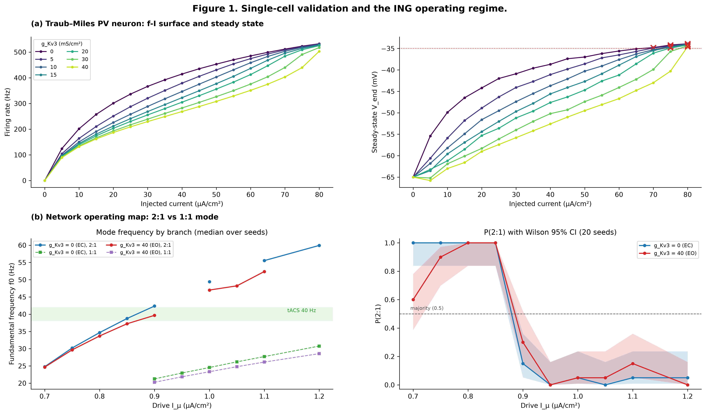
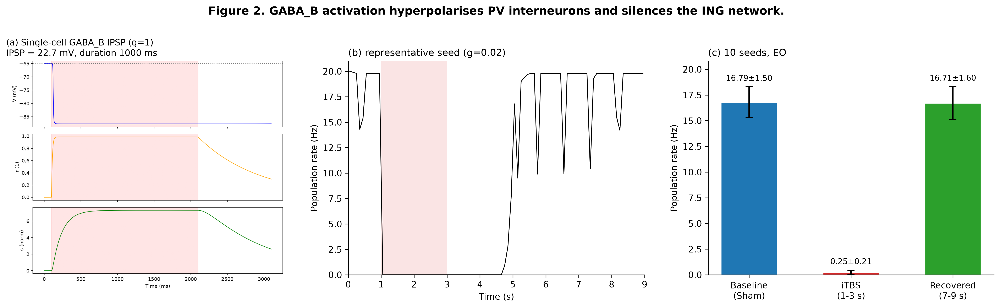
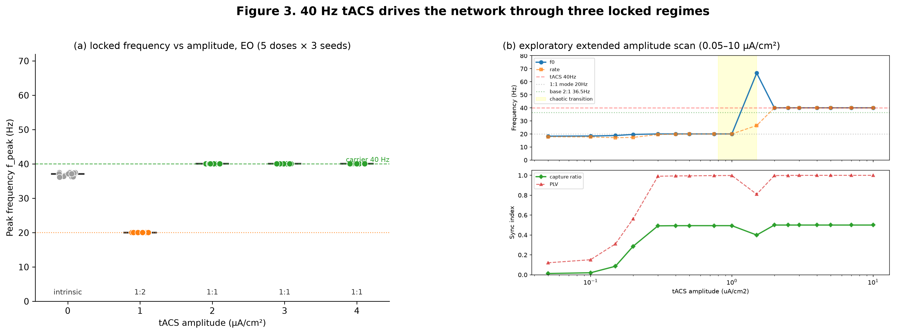
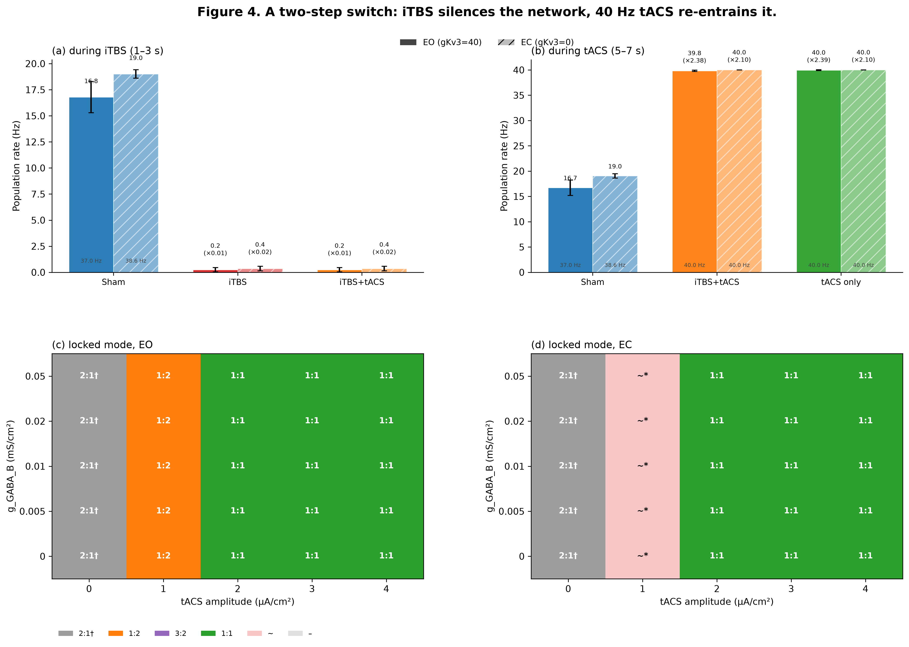
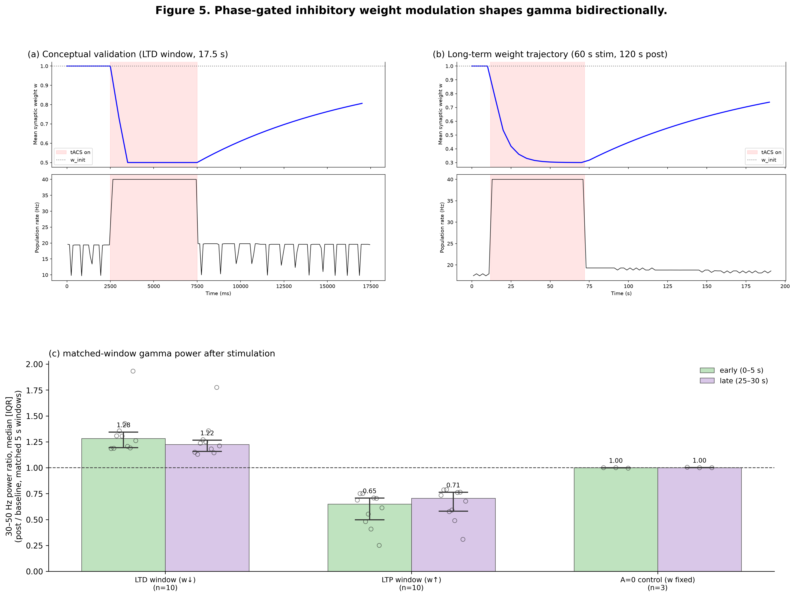

# Introduction

Gamma-band oscillations (30--80 Hz) are essential for higher cognitive functions including attention, working memory, and sensory integration (Whittington et al., 2000). In Alzheimer's disease (AD), gamma power is consistently reduced, and restoring gamma activity---whether by 40 Hz sensory flicker (Iaccarino et al., 2016; Martorell et al., 2019), transcranial alternating current stimulation (tACS), or pharmacological modulation---has emerged as a promising therapeutic strategy, although such entrainment does not extend uniformly to all circuits and species (Soula et al., 2023). Intermittent theta-burst stimulation (iTBS), a form of repetitive transcranial magnetic stimulation, has also shown efficacy in modulating cortical excitability, yet its interaction with concurrent tACS remains poorly understood at the biophysical level. Here we present a computational interneuron-network model that unifies these two neuromodulatory approaches: GABA_B-mediated slow inhibition mimics the synaptic footprint of iTBS-like intervention, while exogenous 40 Hz tACS re-engages the network from a suppressed state. The model provides a mechanistic framework for understanding how sequential iTBS and tACS can act as a gamma "switch" in fast-spiking interneuron circuits. It is intended as a computational baseline for structure--activity research on multimodal gamma-frequency stimulation: the manuscript reports the operating boundaries of the minimal circuit---dose thresholds, state dependence, and their limits---rather than a cellular-scale reconstruction of arousal.

# Methods

## Single-cell model

Individual PV+ interneurons were modelled with the Traub--Miles (TM) Hodgkin--Huxley formalism (Traub & Miles, 1991) as implemented in Brian2 2.7.1 (Stimberg et al., 2019). The membrane equation reads

$$C_m \frac{dV}{dt} = -I_{Na} - I_K - I_L + I_{\mu} + I_{syn} + I_{tACS},$$

where $C_m = 1\,\mu\text{F/cm}^2$, $I_{Na}$ and $I_K$ are the voltage-gated sodium and potassium currents, $I_L$ is the leak current, $I_{\mu}$ is a constant somatic current injection, $I_{syn}$ is the total synaptic current, and $I_{tACS}$ is the external alternating-current stimulus. The A-type potassium current was parametrised by a conductance $g_{\text{Kv3}}$ that was varied between 0 and 40 mS/cm$^2$ to emulate eyes-closed (EC, low $g_{\text{Kv3}}$) and eyes-open (EO, high $g_{\text{Kv3}}$) arousal states (Rudy et al., 2001; Lien & Jonas, 2003; Erisir et al., 1999). Full ionic-current equations and gating kinetics follow the canonical TM description.

## Network architecture

The network comprised $N = 100$ PV+ interneurons coupled by sparse random recurrent GABA$_A$ synapses (connection probability $p_{II} = 0.2$), giving rise to intrinsic gamma-band oscillations (30--80 Hz) via the interneuron-network-gamma (ING) mechanism (Wang & Buzsáki, 1996; Bartos et al., 2007). Each presynaptic spike incremented the synaptic conductance instantaneously, followed by exponential decay with time constant $\tau_{\text{GABA}_A} = 10$ ms, with the conductance clipped at a saturating value. Per-edge peak conductances were normalised so that the mean total inhibition per cell was $0.1$ mS/cm$^2$ ($g_{\text{syn,each}} = 0.1/(N p_{II})$ mS/cm$^2$), and the reversal potential was $E_{\text{GABA}_A} = -75$ mV. Electrical coupling through gap junctions (connection probability $0.1$) was included by default, with the same per-edge normalisation to a mean total gap conductance of $0.2$ mS/cm$^2$ per cell. The somatic drive was heterogeneous across cells, $I_{\text{app}} = I_{\mu}\,[1 + 0.10\,\mathcal{N}(0,1)]$ with negative draws clipped to zero. Unless otherwise stated, the drive current was $I_{\mu} = 0.85\,\mu\text{A/cm}^2$ and the integration time step was $\Delta t = 0.025$ ms. All simulations were executed with Brian2 2.7.1 (Stimberg et al., 2019). The eyes-closed (EC) state was modelled with $g_{\text{Kv3}} = 0$ mS/cm$^2$ and the eyes-open (EO) state with $g_{\text{Kv3}} = 40$ mS/cm$^2$ throughout (operating map and intervention simulations alike); the delayed-rectifier conductance was fixed at $g_{\text{Kdr}} = 20$ mS/cm$^2$ in all network simulations.

## tACS amplitude scaling and field equivalence

The tACS amplitude $A_{\text{tACS}}$ is an internal current-density parameter applied directly to the somatic compartment. It should not be read as a prediction of extracranial dose: the electric field reaching a cortical neuron from scalp electrodes is attenuated and shaped by volume conduction, and the transmembrane current induced in a compact soma depends on cell geometry and orientation (Aspart et al., 2016). Mapping $A_{\text{tACS}}$ to an extracranial field strength would require a volume-conductor model that resolves this attenuation together with cell-type-specific susceptibility; fast-spiking interneurons have been identified as the most susceptible cell class under weak fields (Huang et al., 2021). We therefore report $A_{\text{tACS}}$ values as model-internal bifurcation parameters and restrict all dose--response claims to the model's own parameter space.

## GABA$_B$ conductance (iTBS surrogate)

Slow metabotropic inhibition was modelled with the cooperative GABA$_B$ receptor kinetics of Destexhe (1998) as parametrised by Thomson & Destexhe (1999):

$$\frac{dr}{dt} = K_1\, T\,(1-r) - K_2\, r, \qquad \frac{ds}{dt} = K_{3,\text{eff}}\, r - K_4\, s,$$

where $T$ is the transmitter concentration in the synaptic cleft, $r$ the bound-receptor fraction, and $s$ the activated G-protein concentration; $K_1 = 0.09$ ms$^{-1}$mM$^{-1}$, $K_2 = 0.0012$ ms$^{-1}$, $K_{3,\text{eff}} = K_3 / K_d^{1/n}$, $K_3 = 0.18$, $K_d = 100\,\mu\text{M}^4$, $K_4 = 1/130$ ms$^{-1}$ (corresponding to $\tau_s = 130$ ms), and $n = 4$ cooperative binding sites. The resulting potassium current is

$$I_{\text{GABA}_B} = g_{\text{GABA}_B}\, \frac{s^4}{s^4 + 1}\, (V - E_K),$$

with $E_K = -90$ mV. The iTBS surrogate consisted of a 2 s train (1–3 s) of 20 ms transmitter pulses repeated every 100 ms (10 Hz), applied simultaneously to all interneurons at the network working dose $g_{\text{GABA}_B} = 0.02$ mS/cm$^2$. Because the gating trajectory is cell-independent, the conductance was pre-folded into an equivalent somatic current $I = -g_{\text{GABA}_B}\,[s^4/(s^4+1)]\,(V_{\text{rest}} - E_K)$ with the steady-state driving force $V_{\text{rest}} - E_K = 25$ mV, and injected as a TimedArray, avoiding a per-cell gating loop. This fixed-driving-force approximation is exact only while the membrane voltage sits near $V_{\text{rest}}$; during the pulse train the realised hyperpolarisation is in the low single-digit millivolt range, so the approximation is well controlled for the working dose, but it should not be extrapolated to doses that hyperpolarise the cell substantially (the voltage-dependent conductance form was retained in the single-cell demonstration of Figure 2a). A dose scan at the operating point (seed 42) identified $g = 0.02$ mS/cm$^2$ as the smallest dose on the tested grid that silenced the gamma rhythm ($g = 0.01$ left 24.7% and $g = 0.02$ left 2.9% of sham gamma-band power in the iTBS window).

## tACS protocol

Transcranial alternating current stimulation was modelled as a sinusoidal current injection shared by all neurons. The combined protocol was designed as a mechanism-inspired sequential surrogate for the concurrent, phase-controlled combined stimulation used in the human study of Glinski et al. (2025):

$$I_{tACS}(t) = A_{tACS} \sin(2\pi f_{tACS} t),$$

with carrier frequency $f_{tACS} = 40$ Hz. In the combined intervention, tACS was delivered sequentially: the iTBS surrogate occupied 1–3 s, and the tACS train (2.0 $\mu$A/cm$^2$, 2 s) was delivered at 5–7 s, i.e. with its onset $+2$ s after iTBS offset; a tACS-only arm (same stimulus, no iTBS) served as the entrainment control. For the entrainment characterisation, the amplitude was varied from 0 to 4 $\mu$A/cm$^2$ in integer steps (5 doses, 3 seeds each, at the operating point); an exploratory single-seed extended scan (0.05–10.0 $\mu$A/cm$^2$, 13 points) was used to bound the transition region.

## tACS-phase-gated synaptic plasticity

Plasticity of the GABA$_A$ synapses was implemented as a clock-driven, phase-gated uniform weight modulation: at each 1 ms network step during stimulation, all synapses sharing the same tACS phase were updated by the same factor, gated by the instantaneous tACS phase $\varphi(t)$ rather than by spike pairs or spike timing, in the spirit of in vivo observations that potentiation and depression are biased by the theta phase at which inputs arrive (Hyman et al., 2003). All recurrent synapses were updated together as

$$\Delta w = \pm A\,\max\bigl(0, \cos(2\pi[\varphi - 0.25])\bigr)\,\frac{w - w_{\min}}{w_{\text{init}} - w_{\min}},$$

with update magnitude $A = 3\times 10^{-4}$, weight bounds $w \in [0.3, 2.0]$, and $w_{\text{init}} = 1.0$. Two arms were simulated: a depotentiation (LTD) arm, for which the update is negative during the depolarising crest of the carrier, and a potentiation (LTP) arm, for which it is positive during the opposite (hyperpolarising) half-cycle. The two arms therefore differ jointly in the sign of the weight change and in its phase window, which are shifted by exactly half a carrier cycle; the design does not dissociate a pure window effect from a pure sign effect. After stimulus offset, weights relaxed exponentially back toward $w_{\text{init}}$ with a time constant of 120 s (passive recovery by construction). The plasticity protocol used 30 s of 40 Hz tACS at 2.0 $\mu$A/cm$^2$ followed by 60 s of post-stimulation recording ($n = 10$ seeds per arm), plus a no-learning control arm in which the tACS train was applied at full amplitude but the update magnitude was set to zero ($n = 3$). Post/base ratios were computed with baseline and post-stimulus windows of equal length (1, 2, and 5 s variants; the 5 s windows are reported in the main text).

We note that the gamma band is defined as 30--80 Hz throughout. Band-integrated power (30--50 Hz) is reported only for the post-stimulation ratio analysis of the plasticity experiment; the entrainment and intervention analyses instead use population firing rate, spectral peak frequency, and peak prominence, because a fixed-band integral mis-tracks rhythmic strength when the spectral peak moves between modes (a fixed 30--50 Hz integral can rise while the gamma rhythm is being suppressed).

## Analysis and statistics

Population firing rate was computed from spike counts per cell over each analysis window (mean over cells and seeds). Spectral diagnostics were computed from the mean-subtracted population-rate histogram binned at 1 ms and zero-padded to 8192 points before a real FFT (rectangular windows; no tapering): the peak frequency $f_{\text{peak}}$ is the argmax of the rate power spectrum within a 20--80 Hz search band, the peak prominence is the peak-to-median ratio within the same band, and band power is the integral over 30--50 Hz. In the exploratory extended entrainment scan, phase-locking value (PLV) was computed from the spike--tACS phase distribution. Firing modes were assigned by a carrier-aware classifier: with no applied carrier ($A_{\text{tACS}} = 0$) the rhythm is labelled intrinsic and no locking is claimed; with a carrier applied, 1:1 locking requires both $|f_{\text{peak}} - 40| \leq 1$ Hz and $|\text{rate} - 40| \leq 5$ Hz (one spike per carrier cycle), 1:2 requires $|f_{\text{peak}} - 20| \leq 1$ Hz and $|\text{rate} - 20| \leq 5$ Hz, 3:2 requires $|f_{\text{peak}} - 60| \leq 2.5$ Hz, silent requires rate $< 1$ Hz, and all remaining cases are labelled partial.

Statistical comparisons across $n = 10$ random seeds used two-sided Wilcoxon signed-rank tests on seed-matched pairs (each intervention arm against its own state's sham arm, within the same analysis window); with $n = 10$ the smallest attainable exact two-tailed $p$-value is $0.002$. Effect sizes are reported as rank-biserial $r$. Multiple comparisons were controlled with the Benjamini--Hochberg false-discovery rate (FDR) procedure at $q < 0.05$ (critical value $0.0125$ for $m = 4$). Heavy-tailed ratio quantities (post/base power) are summarised as medians with interquartile ranges and were log$_{10}$-transformed before testing. All reported SDs are population SDs (ddof = 0), matching the values printed by the analysis scripts and displayed in the figures; fold changes are computed against the same-state sham mean within the same analysis window.

All aggregates follow a pre-declared measurement calibre: the grouping key (state, condition, seed, analysis window), the denominator, and the window length were fixed in writing before any figure was rendered, and every figure is re-rendered from frozen CSVs with no new simulations. Every quantity plotted or cited in the text derives from the same frozen tables under the same calibre; where a grouping key was corrected after data freeze (a $g_{\text{Kdr}}$ sensitivity sub-scan inadvertently pooled into one cell of the operating map), the correction and its affected numbers are registered in the repository changelog.

## Simulation parameters

| Parameter | Symbol | Value | Unit |
|-----------|--------|-------|------|
| Network size | $N$ | 100 | neurons |
| Membrane capacitance | $C_m$ | 1.0 | $\mu$F/cm$^2$ |
| Drive current | $I_{\mu}$ | 0.85 | $\mu$A/cm$^2$ |
| Kdr conductance | $g_{\text{Kdr}}$ | 20 | mS/cm$^2$ |
| EO / EC Kv3 conductance | $g_{\text{Kv3}}$ | 40 / 0 | mS/cm$^2$ |
| GABA$_A$ connection probability | $p_{II}$ | 0.2 | -- |
| Mean total GABA$_A$ inhibition per cell | $G_{\text{GABA}_A,\text{total}}$ | 0.1 | mS/cm$^2$ |
| GABA$_A$ decay time | $\tau_{\text{GABA}_A}$ | 10 | ms |
| Gap-junction connection probability | $p_{\text{gap}}$ | 0.1 | -- |
| Mean total gap conductance per cell | $g_{\text{gap,total}}$ | 0.2 | mS/cm$^2$ |
| Drive heterogeneity | $I_{\text{hetero}}$ | 0.10 | -- |
| GABA$_B$ working dose | $g_{\text{GABA}_B}$ | 0.02 | mS/cm$^2$ |
| iTBS surrogate train | -- | 20 ms pulses at 10 Hz, 2 s (1--3 s) | -- |
| GABA$_B$ binding | $K_1$ / $K_2$ | 0.09 / 0.0012 | ms$^{-1}$(mM)$^{-1}$ / ms$^{-1}$ |
| GABA$_B$ G-protein | $K_3$ / $K_4$ | 0.18 / $1/130$ | $\mu$M$\cdot$ms$^{-1}$ / ms$^{-1}$ |
| Cooperativity | $n$, $K_d$ | 4, 100 | --, $\mu$M$^4$ |
| tACS carrier frequency | $f_{tACS}$ | 40 | Hz |
| tACS amplitude (intervention / sweep) | $A_{tACS}$ | 2.0 / 0--4 | $\mu$A/cm$^2$ |
| Plasticity update magnitude | $A$ | $3\times 10^{-4}$ | -- |
| Plasticity weight bounds | $[w_{\min}, w_{\max}]$ | [0.3, 2.0] | -- |
| Plasticity protocol | -- | 30 s stim + 60 s post | s |
| Integration time step | $\Delta t$ | 0.025 | ms |
| Number of random seeds | $n$ | 10 (plasticity control: 3) | -- |

# Results

## Model architecture and validation

We constructed a biophysical network of 100 parvalbumin-positive (PV+) fast-spiking interneurons modelled with Traub-Miles (TM) Hodgkin-Huxley dynamics (Traub & Miles, 1991). Recurrent inhibition was mediated by GABA_A synapses, giving rise to intrinsic gamma-band oscillations (30–80 Hz) via the interneuron-network-gamma (ING) mechanism (Wang & Buzsáki, 1996; Bartos et al., 2007). All simulations were executed in Brian2 (Stimberg et al., 2019). Unless otherwise stated, the drive current was *I*~µ~ = 0.85 $\mu$A/cm$^2$ and the time step was 0.025 ms.

The single-cell model was first validated against the canonical f-I surface (Figure 1a). Raising the A-type potassium conductance *g*~Kv3~ from 0 to 40 mS/cm$^2$ progressively right-shifted the f-I curve and elevated the rheobase, while the steady-state depolarisation block threshold remained near $-$ 35 mV (red crosses in Figure 1a, right panel). This parameter therefore served as a physiologically grounded proxy for the eyes-open (EO, high Kv3) versus eyes-closed (EC, low Kv3) arousal states used throughout the study.

To map the network-level operating regime, we swept the drive current from 0.70 to 1.10 $\mu$A/cm$^2$ in 0.05 steps (plus 1.20 $\mu$A/cm$^2$) at both states ($g_{\text{Kv3}} = 0$ and 40 mS/cm$^2$, $g_{\text{Kdr}} = 20$ mS/cm$^2$, 20 seeds per cell; Figure 1b). At the working point ($I_{\mu} = 0.85\,\mu$A/cm$^2$) both states exhibited the 2:1 firing mode with probability one (P(2:1) = 1.00, $n = 20$ per state), with median fundamental frequencies $f_0 = 38.8$ Hz (EC) and 37.2 Hz (EO). Across the sweep, the EC 2:1 branch ran slightly faster than the EO branch at matched drive. Beyond $I_{\mu} \geq 0.90\,\mu$A/cm$^2$, the 2:1 branch gave way to a stable 1:1 branch at 20--29 Hz, rising with drive, and the probability of 2:1 locking collapsed (at $I_{\mu} = 1.00$: P(2:1) = 0.05 in both states, with residual 2:1 segments at 49.4 Hz in EC and 47.0 Hz in EO; one cell per state, $n = 20$). These benchmarks confirm that the model captures the stereotyped EO/EC gamma frequency difference reported experimentally, and they fix $I_{\mu} = 0.85\,\mu$A/cm$^2$ as the operating point for all subsequent experiments. A $g_{\text{Kdr}}$ sensitivity sub-scan ($g_{\text{Kdr}} \in \{10, 15, 25\}$ mS/cm$^2$ at $I_{\mu} = 1.00$, 20 seeds each) exists in the frozen data but is excluded from the operating map and reported separately.

**Network size sensitivity.** To ensure that the reported frequencies were not artefacts of the chosen network size, we repeated the ING simulation at the operating point (*I*~µ~ = 0.85 $\mu$A/cm$^2$, *g*~Kv3~ = 40 mS/cm$^2$) with N = 50, 100 and 200, using three random seeds each. Per-cell firing rates at every size and seed (14.8--18.0 Hz) were consistent with the 2:1 operating regime of Figure 1b (the frozen sensitivity table records rates but no per-seed mode labels), and at N = 100 the population-rate fundamental was highly reproducible across seeds (*f*~0~ = 18.1 ± 0.2 Hz, CV < 2%). At N = 50 and N = 200 the population-rate spectrum was seed-dependent---some seeds expressing the $\sim$ 18 Hz subharmonic of the 2:1 rhythm, others the $\sim$ 36--37 Hz gamma-band component that emerges when the two firing clusters settle into anti-phase relationship---yielding larger *f*~0~ variance across seeds (24.9 ± 8.7 Hz and 24.0 ± 8.3 Hz, respectively), although the per-cell mode itself did not switch. N = 100 was therefore retained as the standard network size for all subsequent simulations.

## GABA_B activation hyperpolarises PV interneurons and suppresses the ING network

We next introduced the slow GABA$_B$ conductance to mimic the synaptic footprint of iTBS-like metabotropic activation (Glinski et al., 2025). In a single isolated cell, a sustained pulse at a saturating conductance ($g_{\text{GABA}_B} = 1$ mS/cm$^2$) produced a hyperpolarising shift of 22.7 mV (Figure 2a, top trace), with the bound-receptor fraction *r* saturating within ~200 ms and the activated G-protein pool *s* outlasting the stimulus by more than 1 s (middle and bottom traces). This dose is a saturating demonstration of the gating kinetics; the network protocol below uses a 50-fold lower working dose, for which the realised hyperpolarisation during the pulse train is in the low single-digit millivolt range.

At the network level, the iTBS surrogate (20 ms pulses at 10 Hz, 1--3 s, $g = 0.02$ mS/cm$^2$) silenced the gamma rhythm almost completely. Across 10 random seeds, the population firing rate during the train dropped from $16.79 \pm 1.50$ Hz (sham) to $0.25 \pm 0.21$ Hz (98.5% reduction; seed-matched Wilcoxon signed-rank *W* = 0, *p* = 0.002, rank-biserial *r* = 1.00; Figure 2b--c), and recovered to $16.71 \pm 1.60$ Hz in the 7--9 s post-stimulus window. A dedicated recovery run (no tACS) showed that the silence ends $\sim$ 2 s after train offset ($t_{50} = t_{90} = 5$ s absolute time), i.e. quiescence tracks the residual GABA$_B$ conductance rather than any metastable OFF state. These observations establish that metabotropic inhibition is sufficient to transiently shut down the ING pacemaker, providing a mechanistic substrate for the iTBS-induced gamma suppression hypothesised in the therapeutic protocol.

## tACS 40 Hz entrainment reveals four dynamical regimes, three of them locked

We then asked whether exogenous 40 Hz tACS could re-engage the network after GABA$_B$-mediated suppression. The amplitude range was guided by weak-field linear-response theory (Aspart et al., 2016), by dose-dependent spike-timing effects measured in awake nonhuman primates (Johnson et al., 2020), and by in vivo observations that fast-spiking interneurons are the most susceptible targets of weak tACS (Huang et al., 2021). A systematic sweep at the operating point (amplitudes 0, 1, 2, 3 and 4 $\mu$A/cm$^2$, 3 seeds each, EO state, no GABA$_B$; Figure 3a) resolved three locked regimes. Without a carrier (0 $\mu$A/cm$^2$) the network maintained its intrinsic 2:1 rhythm ($f_{\text{peak}}$ median $37.2$ Hz, range $36.4$--$37.6$; $n = 3$); since no carrier was applied, this condition is labelled intrinsic rather than locked. At 1 $\mu$A/cm$^2$ the population locked to the subharmonic (1:2 stimulus-to-spike ratio), with both firing rate and spectral fundamental pinned at 20.0 Hz. At amplitudes $\geq 2\,\mu\text{A/cm}^2$ the network achieved full 1:1 phase locking at 40 Hz---all 45 run combinations across the tested residual-conductance levels (5 levels $\times$ 3 seeds at each of amplitudes 2, 3 and 4 $\mu$A/cm$^2$) classified 1:1, with rates between $39.6$ and $40.0$ Hz.

An exploratory single-seed extended scan (0.05--10.0 $\mu$A/cm$^2$, 13 points; Figure 3b) bounded the transition region: phase coherence (PLV) rose from 0.15 at 0.1 $\mu$A/cm$^2$ to 0.99 at 0.5 $\mu$A/cm$^2$ in the subharmonic regime, dipped to 0.81 with broadband, irregular spectra in the 1.2--1.5 $\mu$A/cm$^2$ band (which we describe descriptively; no formal chaos criterion was computed), and settled to rate 40.0 Hz with PLV $\geq 0.997$ from 2.0 $\mu$A/cm$^2$ upward, remaining stable to the highest tested amplitude. These dose--response curves provide the quantitative boundaries for designing a combined tACS+iTBS protocol: full 1:1 entrainment requires $\geq 2.0\,\mu\text{A/cm}^2$, while the subharmonic lock dominates between $\sim$ 0.5 and 1.0 $\mu$A/cm$^2$.

## Combined intervention switch: iTBS closes gamma, tACS reopens it

Building on the single-mechanism results above, we simulated the full two-step sequential surrogate of the human combined-stimulation protocol (Glinski et al., 2025), at the operating point ($I_{\mu} = 0.85\,\mu$A/cm$^2$, EO and EC states, $n = 10$ seeds). First, the iTBS surrogate (1--3 s) suppressed the gamma rhythm; second, the tACS train (2.0 $\mu$A/cm$^2$, 5--7 s) was delivered with its onset $+2$ s after iTBS offset. Four arms were simulated per state: Sham, iTBS alone, iTBS+tACS (sequential), and tACS-only (Figure 4a,b). Because both the basal rhythm and the entrained rhythm lie inside the gamma band, the switch is now a genuine gamma-band phenomenon: the 2:1 rhythm at 37--39 Hz is silenced and a 1:1 rhythm at the 40 Hz carrier is re-established.

During the iTBS window, firing in the EO state fell from $16.79 \pm 1.50$ Hz (sham) to $0.25 \pm 0.21$ Hz in both the iTBS and iTBS+tACS arms ($\times 0.01$ sham); in the EC state, from $19.01 \pm 0.40$ Hz to $0.35 \pm 0.22$ Hz ($\times 0.02$ sham). During the tACS window, the combined arm re-engaged the network to full 1:1 locking: $39.84 \pm 0.12$ Hz in EO ($\times 2.38$ own-state sham, $f_{\text{peak}} = 40.0$ Hz) and $40.00 \pm 0.01$ Hz in EC ($\times 2.10$ sham). Seed-matched Wilcoxon signed-rank tests against the same state's sham arm were significant for both the iTBS suppression and the combined reopening in both states (all four comparisons: $W = 0$, $p = 0.002$, rank-biserial $r = 1.00$), and all survive Benjamini--Hochberg FDR correction at $q < 0.05$ ($m = 4$).

Two controls delimit the interpretation. First, the tACS-only arm locked equally well ($39.96 \pm 0.08$ Hz EO, $\times 2.39$; $40.00 \pm 0.00$ Hz EC, $\times 2.10$), confirming that the ON state reflects active entrainment by the carrier. Second, the iTBS-alone arm had spontaneously recovered to near-basal firing by the tACS window ($15.91 \pm 1.98$ Hz EO, $\times 0.95$ sham; $18.68 \pm 0.52$ Hz EC, $\times 0.98$ sham), with the gamma-band spectral peak back at sham levels as well (median $f_{\text{peak}}$ 36.9 vs 37.0 Hz EO; 38.4 vs 38.6 Hz EC), so the specific contribution of tACS is the *mode* of the reopened rhythm—1:1 locking to the 40 Hz carrier—rather than firing rate per se. Both states therefore support the switch narrative: iTBS acts as an OFF switch via GABA$_B$, and tACS acts as an ON switch via 1:1 entrainment.

**A historically motivated hypothesis, evaluated and rejected.** Motivated by the state dependence reported by Glinski et al. (2025)---gamma-band enhancement in the eyes-open state but phase-independent suppression in the eyes-closed state---we adopted in an early draft (before the analysis calibre was frozen and never registered) the hypothesis that the EC state would exhibit a larger relative modulation than EO (EO/EC reversal hypothesis). Under the single-parameter Kv3 model this hypothesis was rejected: both states reopened to the same 1:1 mode (a ceiling on rate), and the fold-changes (EO $2.38\times$, EC $2.10\times$) differ only because the basal firing rates differ ($16.7$ vs $19.0$ Hz). We report this negative result explicitly because it delimits the explanatory scope of the Kv3-state mechanism: reproducing the experimentally observed EO/EC asymmetry will likely require additional physiology (e.g., state-dependent input resistance, neuromodulatory tone, or thalamocortical drive) beyond a single Kv3 conductance. A two-dimensional map of residual GABA$_B$ strength ($0$--$0.05$ mS/cm$^2$) by tACS amplitude ($0$--$4\,\mu$A/cm$^2$; Figure 4c,d), classified by the carrier-aware criterion of the Methods, confirmed that the reopening boundary is quantitative, not qualitative: in the EO state, amp $= 1\,\mu$A/cm$^2$ produced stable 1:2 subharmonic locking and amp $\geq 2\,\mu$A/cm$^2$ produced 1:1 locking at every residual GABA$_B$ level; in the EC state, amp $= 1\,\mu$A/cm$^2$ produced only partial entrainment with seed-dependent outcomes (marked * in Figure 4d), and 1:1 locking likewise required amp $\geq 2\,\mu$A/cm$^2$. At amp $= 0$ both states remained in the intrinsic 2:1 rhythm at every GABA$_B$ level. Thus, within this model, state-dependence at sub-locking amplitudes is a difference in entrainment bandwidth rather than a difference in the locked state itself.

## tACS-phase-gated plasticity bidirectionally modulates post-stimulus gamma power

Finally, we incorporated tACS-phase-gated plasticity at the GABA$_A$ synapses to test whether a brief tACS train could leave a lasting trace on network excitability, as reported in human gamma-band aftereffect studies (Glinski et al., 2025), and sustained tACS aftereffects in general depend on brain state (Neuling et al., 2013). During stimulation, the periodic forcing imposes a preferred phase relationship, so a depotentiation-gated arm (weight decreases at the depolarising crest) biases the recurrent inhibition downward, whereas the potentiation-gated arm biases it upward; the two arms differ only in the sign of the phase window (Methods).

In the conceptual validation (17.5 s biological time; Figure 5a), a 5 s tACS train at 40 Hz drove the mean GABA$_A$ weight *w* from 1.0 down to 0.5 in the depotentiation arm, after which *w* recovered only partially to $\sim$ 0.8 over the remaining 12.5 s; the population rate followed the same pattern: it left the 40 Hz lock at stimulus offset and settled back into an oscillatory pattern fluctuating between $\sim$ 10 and 20 Hz---the pre-stimulus range---so the carrier-locked mode does not persist beyond the stimulus, while the mean weight remains below baseline (final $w \approx 0.8$). A long-duration single-run demonstration (60 s stimulation + 120 s post; Figure 5b) showed the same qualitative trajectory at slower resolution: a rapid weight drop during the first $\sim$ 20 s of tACS to a nadir of *w* $\approx 0.3$, followed by a slow drift back toward baseline during the post period—consistent with drift after the offset of phase-locked updates rather than an active homeostatic process.

The population statistics (Figure 5c) were computed from the frozen multi-seed runs ($n = 10$ seeds per arm, plus a no-learning control arm with the tACS train applied at full amplitude but zero update magnitude, $n = 3$), as post/base ratios of gamma-band power with baseline and post-stimulus windows of equal length (matched 5 s windows; 1 s and 2 s variants gave the same direction). Depotentiation-window gating elevated post-stimulus gamma power to $1.28\times$ baseline $[1.19$--$1.34]$ in the early post-stimulus window (0--5 s after offset) and $1.22\times$ $[1.16$--$1.27]$ in the late window (25--30 s), consistent with disinhibition following weakening of the recurrent GABA$_A$ synapses. Potentiation-window gating suppressed gamma power to $0.65\times$ $[0.50$--$0.71]$ and $0.71\times$ $[0.58$--$0.76]$, respectively. The no-learning control remained at $1.00\times$ $[1.00$--$1.00]$ in both windows, confirming that the ratios reflect gated plasticity rather than any window-mismatch artefact (unmatched windows in early analyses had inflated ratios by more than an order of magnitude; this control is what retired them). Medians [IQR] are reported because the per-seed ratios are heavy-tailed. An interpretive caveat accompanies these power ratios: the post-stimulus spectrum does not always peak inside the 30--50 Hz band (the in-band main-peak fraction was 4/10 (early) and 3/10 (late) in the depotentiation arm, and 6/10 and 5/10 in the potentiation arm), so for a substantial fraction of seeds the band integral tracks a shifted or broadband spectrum rather than a clean gamma re-emergence. As an exploratory, post-hoc endpoint, the population firing-rate ratio (post/base, same windows) showed the same direction of effect (depotentiation-arm medians 1.12 early and 1.10 late; potentiation-arm medians 0.81 and 0.84).

Two caveats govern the interpretation of these numbers. First, the measurement windows are seconds long—three orders of magnitude shorter than the 90--120 min window in which the clinical P2 aftereffect of Glinski et al. (2025) was defined; we therefore do not benchmark our result against the clinical +25% criterion, and the two quantities should not be compared directly. Second, the plasticity rule is a phenomenological, clock-driven phase gate applied uniformly to all synapses---not an activity-dependent or spike-pair STDP rule---and the recovery phase is passive exponential drift toward baseline with a 120 s time constant imposed by construction. Within these bounds, the simulations show that tACS-phase-gated plasticity can convert a transient input into a sustained (seconds-scale, still present at 25--30 s) bidirectional modulation of gamma-band power—a synaptic mechanism that could contribute to the longer-window aftereffects reported clinically, but whose persistence across minutes-to-hours timescales this model does not address.

# Data and code availability

All simulation code, figure composition scripts, frozen result tables (CSV), and validation utilities are available at https://github.com/peiyuesong/gamma_sar (branch preprint/v0.2; the v0.2 release is cut at submission). Figures 1--5 are re-rendered directly from the frozen CSVs with no new simulations; all deviations of v0.2 from v0.1, including the post-freeze grouping correction in the Figure 1 operating map, are registered in docs/v0.2_changelog.md.

# Acknowledgements

Not applicable.

# Discussion

The present model demonstrates that a minimal ING circuit---100 sparsely coupled PV+ interneurons (GABA$_A$ connection probability 0.2) with slow GABA$_B$ conductances and exogenous 40 Hz tACS---is sufficient to reproduce the key phenomenology of combined iTBS/tACS neuromodulation: reversible gamma suppression, amplitude-dependent entrainment, and state-dependent dynamic range. Several limitations should be noted. First, the network size ($N = 100$) was chosen as a computational sweet spot (CV $< 2$% across seeds); extrapolation to larger, sparsely connected cortical ensembles will require verification. Second, the model uses single-compartment somatic dynamics, omitting dendritic integration and spatial current spread that could alter tACS efficacy at the population level. Third, the plasticity aftereffect is seconds-scale by construction: the bidirectional power modulation ($+28\%$ depotentiation arm, $-35\%$ potentiation arm) was measured over matched 5 s windows up to 25--30 s after a 30 s train, and its decay is passive drift, so no quantitative bridge to the 90--120 min clinical P2 biomarker is claimed---consistent with the view that tACS aftereffects in vivo reflect plastic changes rather than mere entrainment (Vossen et al., 2015). Fourth, the current implementation treats iTBS as a uniform GABA$_B$ pulse train; the temporal microstructure of actual theta-burst trains (triplet bursts, carrier frequency, train repetition) is collapsed into the 10 Hz gating. Fifth, the arousal states are reduced to a single Kv3 conductance; the frozen data already contain a Kdr sensitivity sub-scan showing that the f-I surface shifts appreciably with $g_{\text{Kdr}}$, hinting that a two-dimensional state model (Kv3 $\times$ Kdr, or Kv3 $\times$ neuromodulatory tone) may be the minimal level at which state-dependent susceptibility differences become qualitative rather than quantitative. A concrete instance is the EC condition at 1 $\mu$A/cm$^2$: entrainment was only partial with seed-dependent outcomes, whereas EO locked stably to the subharmonic—so at sub-locking amplitudes the two states genuinely differ, but this difference vanishes once the carrier is strong enough for 1:1 locking. Finally, the historically motivated EO/EC reversal hypothesis was evaluated and rejected under the single-conductance state model, and reproducing the experimentally observed state dependence (EO enhancement vs. EC phase-independent suppression) will likely require the additional physiology noted above. The amplitude threshold we resolve is itself consistent with evidence that 40 Hz drive does not entrain native gamma rhythms outside the directly driven regime (Soula et al., 2023). Despite these simplifications, the model provides quantitative boundary conditions---tACS amplitude $\geq 2.0\,\mu\text{A/cm}^2$ for 1:1 entrainment, subharmonic locking between $\sim$ 0.5 and 1.0 $\mu$A/cm$^2$, GABA$_B$ $g = 0.02$ mS/cm$^2$ for $>$ 98% suppression---that can guide experimental parameter selection and power analysis.

**Testable predictions.** The model makes four predictions that can be checked in human or animal experiments. (i) Full 1:1 entrainment of an ING rhythm by 40 Hz tACS requires a model-internal amplitude of at least $2.0\,\mu$A/cm$^2$; converting this to extracranial field strength requires a volume-conductor model and is deliberately not attempted here. (ii) If eyes-open/eyes-closed asymmetry in the response to 40 Hz stimulation is observed experimentally, it should be confined to sub-locking doses; at locking doses the two states converge to the same 1:1 rhythm. (iii) After iTBS-like suppression of an ING rhythm, gamma recovery should track the slow inhibitory tail (seconds) rather than outlast it by minutes in the absence of plasticity induction. (iv) Following suppression, tACS should set the *mode* of the reopened rhythm (1:1 locking to the carrier) rather than raise gamma-band power per se. Failures of these predictions would delimit where the minimal-circuit account stops applying.

Future work can be organised along three axes that this study has deliberately bracketed. *Time*: replacing the uniform pulse train with true theta-burst microstructure and testing whether burst-locked GABA$_B$ transients widen the entrainment bandwidth. *Space*: moving from somatic uniform field injection to multi-compartment neurons under spatially non-uniform fields, where cell morphology and orientation determine susceptibility (Aspart et al., 2016; Huang et al., 2021). *Channel*: expanding the state model beyond Kv3---the Kdr sub-scan, Kv3-modulating pharmacology (Rosato-Siri et al., 2015; Boddum et al., 2017), and neuromodulatory tone---to test whether the clinically observed EO/EC dissociation can be recovered mechanistically.

# Funding

Not applicable.

# Figure captions

{width=6.9in}

**Figure 1. Single-cell validation and network operating map.** (a) Steady-state firing rate as a function of drive current and Kv3 conductance (f-I surface, $g_{\text{Kdr}} = 20$ mS/cm$^2$), with the depolarisation-block threshold near $-$ 35 mV marked by red crosses (right panel). (b) Network operating map: fundamental frequency $f_0$ (top) and per-cell probability of 2:1 locking (bottom, Wilson 95% CI) as functions of drive current for the EC state ($g_{\text{Kv3}} = 0$, blue) and the EO state ($g_{\text{Kv3}} = 40$, red); $n = 20$ seeds per cell, main scan $g_{\text{Kdr}} = 20$ mS/cm$^2$; the green band marks the 40 Hz tACS carrier. At $I_{\mu} = 0.85\,\mu$A/cm$^2$ both states sit in the 2:1 mode with P(2:1) = 1.00; the 1:1 branch appears at $I_{\mu} \geq 0.90\,\mu$A/cm$^2$. A $g_{\text{Kdr}}$ sensitivity sub-scan ($g_{\text{Kdr}} \in \{10, 15, 25\}$ mS/cm$^2$, $I_{\mu} = 1.00$ only) is excluded from this map and registered in the repository changelog.

{width=6.9in}

**Figure 2. GABA$_B$ activation hyperpolarises PV interneurons and silences the ING network.** (a) Single-cell response to a sustained GABA$_B$ pulse at a saturating conductance ($g = 1$ mS/cm$^2$): membrane voltage (top), bound-receptor fraction *r* (middle), and activated G-protein pool *s* (bottom); IPSP = 22.7 mV. This dose visualises the gating kinetics only: the network protocol in (b)--(c) uses the 50-fold lower working dose $g = 0.02$ mS/cm$^2$ delivered as 20 ms pulses at 10 Hz, for which the realised hyperpolarisation is in the low single-digit millivolt range. Note that panel (a) shows the voltage-dependent conductance implementation, whereas the network simulations in (b)--(c) used the fixed-driving-force current injection (Methods). (b) Population rate of a representative EO network during the iTBS surrogate (1--3 s, shaded). (c) Ten-seed EO statistics from the same frozen experiment that feeds Figure 4 (mean $\pm$ SD): baseline (sham) $16.79 \pm 1.50$ Hz, iTBS window $0.25 \pm 0.21$ Hz (98.5% suppression), recovery (7--9 s) $16.71 \pm 1.60$ Hz.

{width=6.9in}

**Figure 3. Amplitude-dependent entrainment of the ING network by 40 Hz tACS.** (a) Locked frequency versus amplitude at the operating point (EO, $g_{\text{GABA}_B} = 0$, 5 doses $\times$ 3 seeds), coloured by firing mode under the carrier-aware classifier (grey = intrinsic rhythm, no carrier, so no locking is claimed; orange = 1:2 subharmonic; green = 1:1). (b) Exploratory single-seed extended scan (0.05--10.0 $\mu$A/cm$^2$ at $I_{\mu} = 0.85\,\mu$A/cm$^2$, seed 42): rate spectrogram (top; yellow shading = irregular transition band, 1.2--1.5 $\mu$A/cm$^2$) and phase-locking value (bottom). Under the classifier used throughout, 1:1 locking requires both $|f_{\text{peak}} - 40| \leq 1$ Hz and $|\text{rate} - 40| \leq 5$ Hz; panel (b) is a single exploratory run bounding the transition region, distinct from the multi-seed sweep in (a).

{width=6.9in}

**Figure 4. The combined iTBS/tACS intervention acts as a reversible gamma switch in both arousal states.** (a) Population firing rate during the iTBS window (1--3 s) and (b) during the tACS window (5--7 s), for Sham, iTBS, iTBS+tACS (sequential, $+2$ s offset) and tACS-only arms (bars left to right within each panel as listed); mean $\pm$ SD, $n = 10$ seeds; fold changes are computed against the same state's Sham mean; EO (solid) and EC (hatched). During the tACS window the combined arm locks 1:1 at 40 Hz in both states ($\times 2.38$ EO, $\times 2.10$ EC), as does tACS-only; the iTBS-alone arm has spontaneously recovered to basal firing ($\times 0.95$ EO, $\times 0.98$ EC), so tACS sets the reopened *mode*, not merely the rate. (c,d) Locked-mode maps over residual GABA$_B$ strength ($0$--$0.05$ mS/cm$^2$) by tACS amplitude ($0$--$4\,\mu$A/cm$^2$), EO (c) and EC (d), majority mode per cell under the carrier-aware classifier; * = seeds disagree within the cell. Note the EC state at 1 $\mu$A/cm$^2$: partial entrainment with seed split---in two of three seeds the population spectrum peaks at the carrier (40.0 Hz) yet the per-cell rate sits at only $\sim$ 23 spikes/s rather than one spike per cycle, and one seed expresses 3:2 locking at 60 Hz---versus stable 1:2 locking in EO. The panel (a) iTBS-arm statistics and Figure 2c are the same frozen experiment.

{width=6.9in}

**Figure 5. tACS-phase-gated plasticity of GABA$_A$ weights bidirectionally modulates post-stimulus gamma power.** (a) Conceptual validation (single run, 17.5 s): mean synaptic weight and population rate through a 5 s tACS train and the post-stimulus period (depotentiation arm). (b) Long-duration single-run demonstration (60 s stimulation + 120 s post): weight trajectory (depotentiation arm). (c) Population statistics from the frozen multi-seed runs ($n = 10$ per arm; no-learning control with tACS applied, $n = 3$): post/base gamma-band power ratios with matched 5 s windows (early = 0--5 s after stimulus offset; late = 25--30 s), medians with IQR whiskers over per-seed ratios. Depotentiation-window gating: $1.28\times$ $[1.19$--$1.34]$ (early) and $1.22\times$ $[1.16$--$1.27]$ (late); potentiation-window gating: $0.65\times$ $[0.50$--$0.71]$ and $0.71\times$ $[0.58$--$0.76]$; control: $1.00\times$ $[1.00$--$1.00]$. Panels (a)--(b) are illustrative single runs; all quantitative claims rest on (c).

# References

1. Wang, X.-J., & Buzsáki, G. (1996). Gamma oscillation by synaptic inhibition in a hippocampal interneuronal network model. *Journal of Neuroscience*, 16(20), 6402--6413.

2. Bartos, M., Vida, I., & Jonas, P. (2007). Synaptic mechanisms of synchronized gamma oscillations in inhibitory interneuron networks. *Nature Reviews Neuroscience*, 8(1), 45--56.

3. Whittington, M. A., Traub, R. D., Kopell, N., Ermentrout, B., & Buhl, E. H. (2000). Inhibition-based rhythms: experimental and mathematical observations on network dynamics. *International Journal of Psychophysiology*, 38(3), 315--336.

4. Traub, R. D., & Miles, R. (1991). *Neuronal Networks of the Hippocampus*. Cambridge University Press.

5. Rudy, B., & McBain, C. J. (2001). Kv3 channels: voltage-gated K+ channels designed for high-frequency repetitive firing. *Trends in Neurosciences*, 24(9), 517--526.

6. Lien, C.-C., & Jonas, P. (2003). Kv3 potassium conductance is necessary and kinetically optimized for high-frequency action potential generation in hippocampal interneurons. *Journal of Neuroscience*, 23(6), 2058--2068.

7. Erisir, A., Lau, D., Rudy, B., & Leonard, C. S. (1999). Function of specific K+ channels in sustained high-frequency firing of fast-spiking neocortical interneurons. *Journal of Neurophysiology*, 82(5), 2476--2489.

8. Huang, W. A., Stitt, I. M., Negahbani, E., Passey, D. J., Ahn, S., Davey, M., Dannhauer, M., Doan, T. T., Hoover, A. C., Peterchev, A. V., Radtke-Schuller, S., & Fröhlich, F. (2021). Transcranial alternating current stimulation entrains alpha oscillations by preferential phase synchronization of fast-spiking cortical neurons to stimulation waveform. *Nature Communications*, 12, 3151.

9. Destexhe, A. (1998). Spike-and-wave oscillations based on the properties of GABA_B receptors. *Journal of Neuroscience*, 18(21), 9099--9111.

10. Thomson, A. M., & Destexhe, A. (1999). Dual intracellular recordings and computational models of slow inhibitory postsynaptic potentials in rat neocortical and hippocampal slices. *Neuroscience*, 92(4), 1193--1215.

11. Glinski, B., Ali Salehinejad, M., Takahashi, K., Jamil, A., Yavari, F., Kuo, M.-F., & Nitsche, M. A. (2025). Phase-synchronized 40Hz tACS and iTBS effects on gamma oscillations. *Imaging Neuroscience*, 3, imag.a.140.

12. Aspart, F., Ladenbauer, J., & Obermayer, K. (2016). Extending integrate-and-fire model neurons to account for the effects of weak electric fields and input filtering mediated by the dendrite. *PLOS Computational Biology*, 12(11), e1005206.

13. Martorell, A. J., Paulson, A. L., Suk, H.-J., Abdurrob, F., Drummond, G. T., Guan, W., ... Tsai, L.-H. (2019). Multi-sensory gamma stimulation ameliorates Alzheimer's-associated pathology and improves cognition. *Cell*, 177(2), 256--271.

14. Iaccarino, H. F., Singer, A. C., Martorell, A. J., Rudenko, A., Gao, F., Gillingham, T. Z., ... Tsai, L.-H. (2016). Gamma frequency entrainment attenuates amyloid load and modifies microglia. *Nature*, 540(7632), 230--235.

15. Soula, M., Martín-Ávila, A., Zhang, Y., Dhingra, A., Nitzan, N., Sadowski, M. J., Gan, W.-B., & Buzsáki, G. (2023). Forty-hertz light stimulation does not entrain native gamma oscillations in Alzheimer's disease model mice. *Nature Neuroscience*, 26(4), 570--578.

16. Hyman, J. M., Wyble, B. P., Goyal, V., Rossi, C. A., & Hasselmo, M. E. (2003). Stimulation in hippocampal region CA1 in behaving rats yields long-term potentiation when delivered to the peak of theta and long-term depression when delivered to the trough. *Journal of Neuroscience*, 23(35), 11725--11731.

17. Johnson, L., Alekseichuk, I., Krieg, J., Doyle, A., Yu, Y., Vitek, J., ... Opitz, A. (2020). Dose-dependent effects of transcranial alternating current stimulation on spike timing in awake nonhuman primates. *Science Advances*, 6(36), eaaz2747.

18. Briley, P. M., Boutry, C., Webster, L., Veniero, D., Harvey-Seutcheu, C., Jung, J., Liddle, P. F., & Morriss, R. (2024). Intermittent theta burst stimulation with synchronised transcranial alternating current stimulation leads to enhanced frontal theta oscillations and a positive shift in emotional bias. *Imaging Neuroscience*, 2, 1--14.

19. Takahashi, K., Glinski, B., Salehinejad, M. A., Jamil, A., Chang, A. Y.-C., Kuo, M.-F., & Nitsche, M. A. (2024). Induction and stabilization of delta frequency brain oscillations by phase-synchronized rTMS and tACS. *Brain Stimulation*, 17(5), 1086--1097.

20. Neuling, T., Rach, S., & Herrmann, C. S. (2013). Orchestrating neuronal networks: sustained after-effects of transcranial alternating current stimulation depend upon brain states. *Frontiers in Human Neuroscience*, 7, 161.

21. Rosato-Siri, M. D., Zambello, E., Mutinelli, C., Garbati, N., Benedetti, R., Aldegheri, L., Graziani, F., Virginio, C., Alvaro, G., & Large, C. H. (2015). A novel modulator of Kv3 potassium channels regulates the firing of parvalbumin-positive cortical interneurons. *Journal of Pharmacology and Experimental Therapeutics*, 354(3), 251--260.

22. Boddum, K., Hougaard, C., Lin, J. X.-Y., von Schoubye, N. L., Jensen, H. S., Grunnet, M., & Jespersen, T. (2017). Kv3.1/Kv3.2 channel positive modulators enable faster activating kinetics and increase firing frequency in fast-spiking GABAergic interneurons. *Neuropharmacology*, 118, 102--112.

23. Vossen, A., Gross, J., & Thut, G. (2015). Alpha power increase after transcranial alternating current stimulation at alpha frequency (alpha-tACS) reflects plastic changes rather than entrainment. *Brain Stimulation*, 8(3), 499--508.

24. Stimberg, M., Brette, R., & Goodman, D. F. (2019). Brian 2, an intuitive and efficient neural simulator. *eLife*, 8, e47314.
